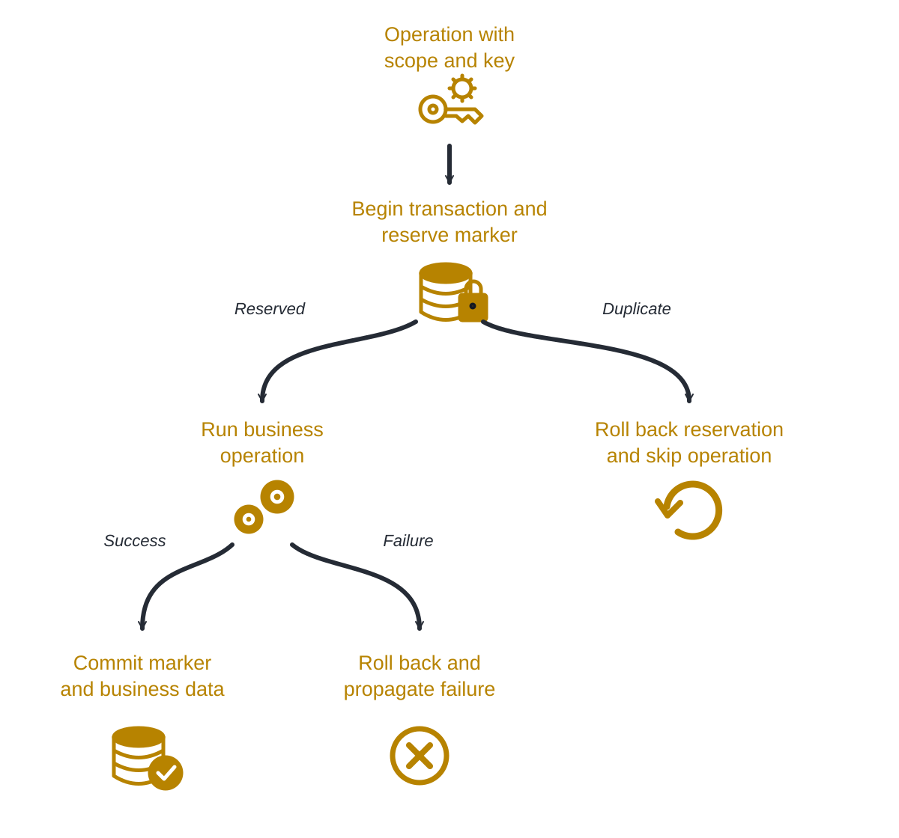

<h1 align="center">Namastack Once</h1>

Transactional idempotency with duplicate protection, flexible retention and observability.

---

  

    <a href="docs/reference.md">Documentation</a> ·
    <a href="docs/reference.md#dependency">Getting Started</a> ·
    <a href="https://github.com/namastack/namastack-once/releases">Releases</a> ·
    <a href="https://github.com/namastack/namastack-once/discussions">Community</a>
  

---

Namastack Once is an open-source **transactional idempotency implementation for Spring Boot**, built for reliable
business operations with Java and Kotlin.

It commits a duplicate-detection marker atomically with your business data and skips repeated operations sharing the
same scope and key, with built-in support for retention, cleanup and observability — using your existing database.

**[Explore the documentation →](docs/reference.md)**

## Why Namastack Once?

Reliable duplicate protection becomes surprisingly difficult once retries, concurrency and multiple application
instances enter the picture.

Namastack Once handles these concerns as part of your Spring Boot application.

* **Transactional guarantees** — commit the marker and protected business writes in one local transaction
* **Duplicate protection** — skip already committed work identified by a stable scope and key
* **Concurrent consumers** — coordinate duplicate detection across instances through the shared database
* **Annotation and programmatic APIs** — use `@Idempotent` or `IdempotencyOperations.execute`
* **Flexible retention** — retain markers indefinitely or configure expiry with automatic cleanup
* **Observability** — optional Micrometer metrics and distributed tracing for execution and cleanup
* **Flexible persistence** — JDBC for relational databases and native MongoDB transactions
* **Multiple instances** — configure named Once beans for separate databases or marker tables
* **Spring Modulith support** — protect asynchronous module listeners against repeated delivery

---

## How It Works

Once reserves a marker for the operation's scope and key, runs your business operation and commits both together.
A duplicate skips the operation; a failure rolls back the transaction so a later delivery can try again.

  <picture>
    <source
      media="(prefers-color-scheme: dark)"
      srcset="./.github/assets/idempotency_diagram_dark.svg"
    >
    <source
      media="(prefers-color-scheme: light)"
      srcset="./.github/assets/idempotency_diagram_light.svg"
    >
    
  </picture>

Protected writes must share Once's database resource and transaction manager. Remote calls and other external effects
are outside that transaction. Once owns the transaction, so invoke it outside an existing transaction.

---

## Documentation

Everything you need to get started, configure and operate Namastack Once is available in the repository documentation.

* **[Getting Started →](docs/reference.md#dependency)** — add a starter and apply the database schema
* **[Reference →](docs/reference.md)** — APIs, transactions, retention, persistence and observability
* **[Examples →](namastack-once-examples/README.md)** — Java, Kotlin, PostgreSQL, MongoDB, Modulith and tracing
* **[Build and Test →](docs/reference.md#build-and-test)** — local development and database verification

---

## Releases and Compatibility

Namastack Once is in initial development toward **0.1.0**. Development builds use **0.1.0-SNAPSHOT**; this repository
is an initial implementation, not a published release.

The project targets Java 17 or later and Spring Boot 4.1. Review the
**[Release Guide](RELEASING.md)** for versioning and release procedures, and the
**[Security Policy](SECURITY.md)** for supported versions and vulnerability reporting.

---

## Community

Namastack Once is open source and contributions of all sizes are welcome.

* [GitHub Discussions](https://github.com/namastack/namastack-once/discussions) — questions, ideas and general
  discussion
* [GitHub Issues](https://github.com/namastack/namastack-once/issues) — bugs and feature requests
* [Discord](https://discord.gg/XNHP5Yhxy7) — chat with the community
* [Contributing Guide](CONTRIBUTING.md) — contribute to the project
* [Project Governance](GOVERNANCE.md) — roles and decision-making process

---

## Contributors

Thanks to everyone who has contributed to Namastack Once.

---

## Support the Project

Namastack Once is independently developed and maintained as open-source software.

If Namastack Once helps you or your team, sponsoring the project helps support its continued development, maintenance
and documentation.

---

## License

Namastack Once is licensed under the [Apache License 2.0](LICENSE).
